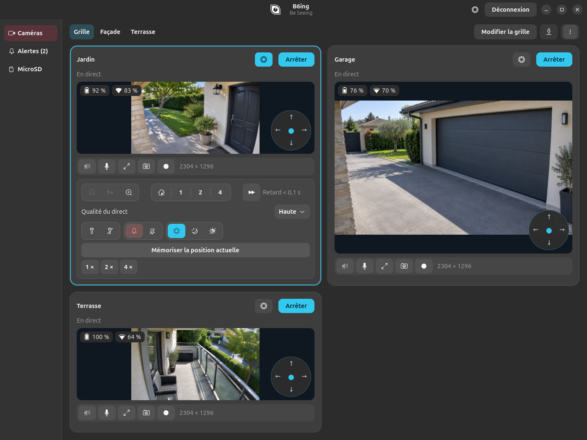
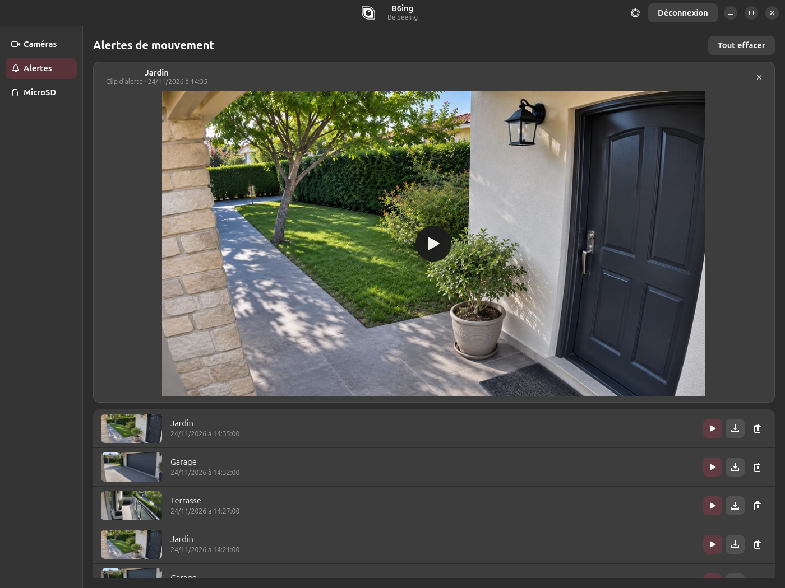
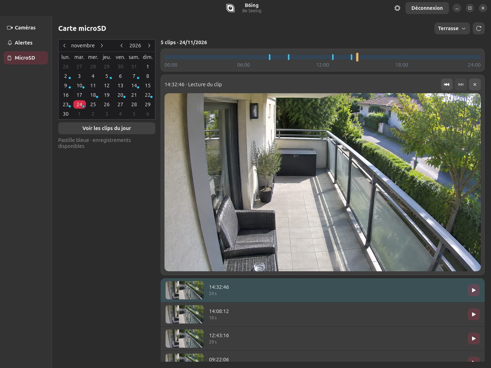

<p align="center">
  
</p>

# B6ing — Be Seeing

B6ing est une application de bureau pour voir et piloter des caméras solaires **Cinnado B6** sur Ubuntu. Elle affiche les directs de ton compte Wansview Cloud dans une grille GTK 4 et libadwaita, sans téléphone, Wine ni Waydroid.

## Aperçu

Les captures montrent B6ing 0.3.1 avec des images et des données de démonstration.

### Caméras



### Alertes



### MicroSD



## Fonctionnalités

- **Direct** en grille personnalisable ou en plein écran, vues mémorisées, profils Haute et Éco, retard estimé et bouton de retour au direct.
- **Commandes** sur chaque vignette et en plein écran. Oriente la caméra au joystick ou avec les flèches du clavier. Pilote la lumière, la sirène et la vision jour/nuit.
- **Cadrage** avec zoom numérique jusqu’à 4× et positions favorites sur les caméras compatibles.
- **Audio** pour écouter la caméra et parler en maintenant le bouton microphone.
- **Captures et enregistrements** en PNG et MKV, avec deux dossiers configurables. Les noms de fichiers reprennent le nom de la caméra et l’heure de début, avec la date.
- **État des caméras** avec niveau de batterie, signal Wi-Fi et notifications de mouvement, selon les données renvoyées par Wansview Cloud.
- **Journal d’alertes** avec miniatures, lecteur intégré et téléchargement des clips disponibles dans AJCloud.
- **MicroSD** avec calendrier, pastilles sur les jours enregistrés, frise cliquable, miniatures et lecture à distance sur les caméras compatibles.
- **Intégration Ubuntu** avec mémorisation facultative du compte dans le trousseau, icône de zone de notification et démarrage réduit à l’ouverture de session.

## Installation sur Ubuntu

Environnement testé sur **Ubuntu 26.04 avec GNOME**. Le direct utilise GStreamer. Le trousseau de session sert à mémoriser le compte.

```sh
sudo apt install git python3-gi python3-venv gir1.2-gtk-4.0 gir1.2-adw-1 \
  gir1.2-gstreamer-1.0 gir1.2-secret-1 gstreamer1.0-gtk4 \
  gstreamer1.0-plugins-base gstreamer1.0-plugins-good \
  gstreamer1.0-plugins-bad gstreamer1.0-libav

git clone https://github.com/Chrisnox-209/B6ing.git
cd B6ing
/usr/bin/python3 -m venv --system-site-packages .venv
.venv/bin/python -m pip install -r requirements-cinnado.txt
/usr/bin/python3 install.py
```

Ouvre **B6ing** depuis le menu Applications ou lance `.venv/bin/python -m cinnado_live` depuis le dossier du projet. Le raccourci utilise ce dossier. Relance l’installateur après l’avoir déplacé.

## Utilisation

1. Connecte-toi avec le compte Wansview Cloud auquel les caméras sont déjà associées. Active **Mémoriser le compte sur ce PC** pour utiliser le trousseau Ubuntu.
2. Clique sur **Voir le direct**. Pour piloter une caméra au clavier, sélectionne sa vignette puis maintiens **↑**, **↓**, **←** ou **→**. En plein écran, les flèches pilotent la caméra affichée.
3. Ouvre **Réglages** pour renommer les caméras, choisir les dossiers des photos et vidéos, recevoir les alertes de mouvement ou activer le démarrage réduit. Utilise le menu de l’icône de notification pour réafficher la fenêtre ou quitter B6ing.

Dans **Caméras**, clique sur **Modifier la grille**. Glisse les vignettes avec la poignée ou utilise les flèches. **Agrandir** donne toute la largeur à une caméra. L’icône de sauvegarde mémorise la disposition sous un nom. Clique sur ce nom pour la retrouver.

L’engrenage ouvre les réglages directement sous les commandes de la vignette. Pendant le direct, utilise **−** et **+** pour zoomer jusqu’à 4×, puis glisse dans l’image pour déplacer le cadrage. Sur les caméras compatibles, tu peux mémoriser jusqu’à quatre positions. Les numéros rappellent les positions Wansview Cloud et la maison rappelle le premier emplacement enregistré. **Revenir au direct** attend une image clé récente pour rattraper le retard estimé. B6ing peut rouvrir le flux si nécessaire, hors enregistrement local.

Dans **Alertes**, le journal conserve les 200 derniers mouvements reçus par B6ing et affiche les miniatures disponibles dans AJCloud. À l’ouverture des alertes, le lecteur charge le clip le plus récent au-dessus de la liste et le laisse en pause. **▶** lance la lecture. L’icône de téléchargement enregistre la vidéo dans le dossier choisi dans **Réglages**. Tu peux effacer une alerte ou vider le journal avec **Tout effacer**.

Dans **MicroSD**, les pastilles bleues indiquent les jours contenant des enregistrements. Sélectionne une caméra et une date, puis clique sur **Voir les clips du jour**. Les bandes de la frise ouvrent les clips correspondants dans le lecteur intégré. B6ing génère les miniatures des clips visibles à partir des images enregistrées sur la carte. La disponibilité de la lecture et des commandes dépend du modèle et de la connexion de la caméra.

## Développement

```sh
.venv/bin/python -m unittest discover -s tests -v
```

B6ing est un projet indépendant. Le module de connexion embarqué dérive de [papou-github/wansview-r2](https://github.com/papou-github/wansview-r2). Les détails de l’intégration et sa licence MIT figurent dans [UPSTREAM.md](cinnado_live/vendor_r2/UPSTREAM.md) et [LICENSE](cinnado_live/vendor_r2/LICENSE).
